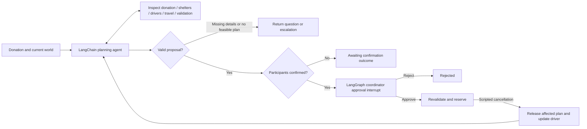

# SF Food Rescue Dispatch

A class project testing whether a tool-using agent can coordinate restaurant
surplus pickups and recover from disruptions better than a nearest-shelter rule.

The implementation uses **LangChain** for the tool-calling agent, **LangGraph** for
workflow control and approval interrupts, **SQLite** for durable demo checkpoints,
**Nebius** for model inference, and **LangSmith** for evaluation experiments.

All organizations, people, donations, confirmations, and routes are fictional.
Neighborhood coordinates approximate San Francisco geography. No real messages,
deliveries, or bookings are made.

## Deploy to Streamlit Community Cloud

1. Open [Streamlit Community Cloud](https://share.streamlit.io/) and create an app.
2. Select repository `vineelad/food_rescue_coordinator`, branch `main`, and entrypoint `app.py`.
3. Under **Advanced settings**, select **Python 3.13**, matching the tested environment.
4. Paste your credentials using the format in [.streamlit/secrets.toml.example](.streamlit/secrets.toml.example).
   Leave credentials empty to deploy a baseline-only demo. Enable LangSmith tracing
   only when its API key is set. Do not also set `LANGSMITH_PROJECT` when using the
   agent destination variables.
5. Click **Deploy**. Subsequent pushes to `main` update the app.

Streamlit root-level secrets become environment variables, so the same Nebius and
LangSmith configuration works in the cloud. Real secrets, local SQLite data, and
the virtual environment are excluded from Git. GitHub Actions runs the tests on
Linux with Python 3.13.

Hosted SQLite files are temporary: saved rescues can disappear when the app
restarts or redeploys. Download plans you want to keep; persistent hosting storage
is a later extension. Hosted simulated rescues are visible to other app viewers.

## Set up (PowerShell)

```powershell
python -m venv .venv
.\.venv\Scripts\python.exe -m pip install -r requirements.txt
Copy-Item .env.example .env
```

Set `NEBIUS_API_KEY` and `NEBIUS_MODEL` in `.env`. Choose the exact ID of a chat
model with **tool calling** enabled in your Nebius account. The base URL defaults
to `https://api.tokenfactory.nebius.com/v1/` and can be overridden for your account.
The API key is passed to Nebius through LangChain's OpenAI-compatible chat client;
an OpenAI API key is not needed.

For LangSmith, also set `LANGSMITH_API_KEY`. Set `LANGSMITH_TRACING=true` if you
want traces from demo runs. Evaluation commands explicitly upload experiments
when `--langsmith` is supplied. Keep `.env` private.

`LANGSMITH_ENDPOINT=https://api.smith.langchain.com` selects the LangSmith API.
`LANGSMITH_AGENT_ID=vin` and `LANGSMITH_AGENT_ENVIRONMENT=local` select the
agent destination in LangSmith. Do not also set `LANGSMITH_PROJECT`: this SDK
rejects competing destinations. The CLI also attaches these values as `agent_id`
and `agent_environment` metadata. They do not replace the API key.

## Run a demo

### Streamlit coordinator

```powershell
.\.venv\Scripts\python.exe -m streamlit run app.py
```

Open **http://localhost:8501**. The Second Serving interface includes SF-themed
hero artwork, a neighborhood map, donation customization, plan review, and
**Approve pickups** / **Decline plan** buttons. The agent runs only when you
request a plan; select the baseline for an immediate credential-free demo.

Saved rescues share the CLI's SQLite database. Choose **Continue a saved rescue**
under **Your dispatch desk** or open a URL with `?rescue=THREAD_ID`. A scripted cancellation
produces a revised proposal requiring a second approval. A stale decision from
another tab is refused; refresh before deciding. The approval control resumes
the real LangGraph interrupt and saves the resulting reservations.

After approving any rescue, use **Plans changed? Redirect the pickup** to select
an assigned driver and click **Cancel driver & replan**. The same saved workflow
releases this donation's reservations, excludes the cancelled driver, and shows a
before/after driver summary with updated pickup cards and map. The replacement
plan requires fresh approval. If no replacement is feasible, the app explains
that coordinator help is needed. This simulation supports pre-pickup cancellation.

The Agent activity tab shows tool calls and planning history. The Evaluation lab
runs local metrics or uploads an experiment to LangSmith. Evaluation approvals
are simulated separately and never approve the rescue on the dispatch board.

This app is a classroom demo without authentication. For local-only access, add
`--server.address 127.0.0.1` to the launch command. Each new scenario has its own simulated world;
it is not a shared live city-wide inventory. Map tiles require internet; all
planning and approval controls remain independent of the basemap.

The generated hero is saved in `assets/sf-food-rescue-hero.png`; its generation
prompt and provenance are in [assets/README.md](assets/README.md).

### Command line

The deterministic baseline needs no credentials:

```powershell
.\.venv\Scripts\python.exe -m food_rescue scenarios
.\.venv\Scripts\python.exe -m food_rescue demo --planner baseline --scenario split_donation
```

The result includes the proposal and a thread ID. It pauses **before** creating
reservations. Copy the printed ID to approve or reject in a separate process:

```powershell
.\.venv\Scripts\python.exe -m food_rescue resume THREAD_ID --decision approve
```

With Nebius credentials configured:

```powershell
.\.venv\Scripts\python.exe -m food_rescue demo --planner agent --scenario driver_cancellation
```

After the first approval, this scenario simulates a pre-pickup driver cancellation,
releases this donation's reservations, replans against the changed world, and
pauses for **another approval**. Other donations' bookings remain intact.
SQLite state lives in `.runs/checkpoints.sqlite`; run commands from this folder.

## Agent and workflow



The agent chooses its tools and submits a structured plan. The scheduling layer
enforces capacities, eligibility, travel/loading time, receiving hours, driver
availability, existing reservations, donation totals, and participant confirmations.
An agent cannot approve its own proposal or directly create reservations.

The simulation has 10 restaurants, 6 shelters, and 5 drivers in Mission, SoMa,
Tenderloin, Chinatown, and Bayview. All times are integer minutes after midnight
in **America/Los_Angeles**; for example, 900 is 3 p.m.

## Evaluations

The same deterministic evaluators work locally and in LangSmith. Each example
gets a fresh world and checkpoint thread. Only the evaluation harness simulates
coordinator approvals automatically; interactive demos require an explicit decision.

```powershell
# Baseline: no credentials or external services
.\.venv\Scripts\python.exe -m food_rescue eval --planner baseline --split all

# Nebius agent: local metrics; repetitions expose model variation
.\.venv\Scripts\python.exe -m food_rescue eval --planner agent --split dev --repetitions 3

# LangSmith: run both against identical development examples
.\.venv\Scripts\python.exe -m food_rescue eval --planner baseline --langsmith --split dev
.\.venv\Scripts\python.exe -m food_rescue eval --planner agent --langsmith --split dev --repetitions 3

# After prompt tuning, assess the held-out scenarios
.\.venv\Scripts\python.exe -m food_rescue eval --planner agent --langsmith --split test --repetitions 3
```

LangSmith creates/reuses the versioned `sf-food-rescue-v1` dataset, with named
examples and `dev`/`test` splits. Compare `sf-baseline-dev` and `sf-agent-dev`
experiments in its UI. The dataset is seeded only on first creation: change the
dataset version when changing scenarios rather than silently mixing versions.

| Metric | Meaning |
| --- | --- |
| `outcome_pass` | Expected outcome and minimum scheduled meal count achieved |
| `committed_plan_valid` | Committed legs satisfy all simulation constraints |
| `proposed_plan_valid` | Proposed legs satisfy all simulation constraints |
| `approval_respected` | Reservations exist only after approval and scheduling |
| `existing_bookings_preserved` | Other donations' reservations remain intact |
| `recovery_pass` | Cancellation applied; revised plan scheduled without cancelled driver |
| `scheduled_meals` / `allocation_rate` | Meals allocated to confirmed pickups, not delivered meals |
| `tool_calls` / `total_tokens` / `latency_seconds` | Agent effort and run time, including replanning |

Never interpret validity alone as task success: no reservations is vacuously valid,
but failing to schedule a feasible donation fails `outcome_pass`. We score feasible
outcomes rather than require one exact route or tool sequence. Model-reported token
counts may be unavailable from a provider, in which case they are zero. Monetary
cost is not estimated without verified model-specific pricing.

The eleven initial cases cover straightforward allocation, splitting, missing
information, no transport, incompatible food, impossible deadlines, pending
confirmations, cancellation recovery, existing bookings, limited capacity, and
scarce transport. In the scarce-transport case, the greedy baseline schedules 40
of 60 meals; a feasible 60-meal plan assigns the larger vehicle to the larger
recipient. This is an opportunity for the agent to outperform the baseline, not
a claim that an untested model already does so.
Three scenarios are marked held-out for prompt development; this is a small class
benchmark, not evidence of real-world dispatch reliability.

## Verify

```powershell
.\.venv\Scripts\python.exe -m pytest -q
```

Tests include persisted approval/resume across connections, rejection without
reservations, capacity and timing violations, duplicate booking prevention,
cancellation recovery, and a real LangChain tool loop with a scripted model.
The scripted model test does not validate a particular Nebius model's behavior.

## Current scope and next increments

This first version accepts structured scenario donations. It does not yet parse
free-text restaurant messages, integrate live routing or messaging,
or track pickup/delivery completion. A pending participant confirmation is an
outcome; live confirmation updates are a later workflow extension. Driver recovery
is a scripted pre-pickup event, not a live event queue.

Travel uses straight-line distance at a fixed assumed speed plus overhead; each
driver can make one direct trip per donation. Meal counts stand in for vehicle
volume. Food compatibility is a synthetic category rule and does not implement
real food handling or safety requirements.

Useful next increments: free-text intake with clarification turns; stale-capacity
and tool-failure scenarios; an explanation-quality rubric checked by a Nebius LLM
judge and human reviewers; and a coordinator interface showing plans and traces.

Framework references: [LangChain agents](https://docs.langchain.com/oss/python/langchain/agents),
[LangGraph interrupts](https://docs.langchain.com/oss/python/langgraph/interrupts),
[LangSmith evaluations](https://docs.langchain.com/langsmith/evaluation),
[Nebius Token Factory](https://dev.nebius.com/token-factory).
